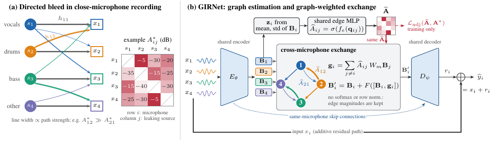

# GIRNet

Official research code for **GIRNet: Directed-Graph Learning for Interpretable
Microphone Bleed Reduction**.

GIRNet is an end-to-end waveform separator for ordered close-microphone
recordings. It estimates a segment-level directed graph in which
`A[i, j]` represents source `j` leaking into microphone `i`, then uses those
same edge values to weight cross-microphone message passing. The graph is not
row-normalized and is supervised from known acoustic paths in simulated data.

**Authors:** Rajesh Rameshbabu, Santhosh Reddy, Ryan M. Corey, and Padmanabhan
Rajan.

- Supplementary website: <https://listeningtech.github.io/girnet/>
- Existing audio-demo mirror: <https://its-rajesh.github.io/rajesh/papers/girnet/>
- Manuscript status: in review at IEEE Signal Processing Letters



## Main verified results

The principal test set contains 4,500 five-second convolutive mixtures from 50
held-out MUSDB18HQ songs. Each mixture contains all nine directed path levels
from -40 to 0 dB across its 12 off-diagonal edges.

| Result | Value |
|---|---:|
| SI-SDR improvement | 5.447 dB |
| SIR improvement | 12.152 dB |
| Graph correlation | 0.810 |
| Pair-order accuracy | 85.75% |
| Strongest-edge accuracy | 44.51% (8.33% chance) |
| Edge MAE | 5.29 dB |

With separator weights fixed, replacing the predicted graph by the oracle
improves SI-SDRi by 0.484 dB. Transposing the oracle graph lowers SI-SDRi by
7.437 dB, while shuffling its directed edge values lowers it by 6.366 dB. These
interventions show that the separator uses source-to-microphone edge identity
and direction, not only the multiset of edge magnitudes.

See [`results/transpose_intervention`](results/transpose_intervention) for the
20,000-replicate complete-song bootstrap results and provenance.

## Repository layout

```text
girnet/                       model, losses, data, metrics, provenance
configs/                      canonical GIRNet and controlled variants
scripts/                      manifest generation, training, evaluation
tests/                        CPU-only smoke and reporting tests
docs/                         architecture and experimental protocols
results/                      aggregate results and provenance
legacy_v3/                    archived TensorFlow/GAT prototype
```

The current PyTorch V4 implementation is independent of the archived V3
prototype. External methods such as HTDemucs, cGANIR, CAE, and KAMIR are
comparison systems only; GIRNet does not use their architectures or weights.

## Installation

Python 3.10 or later is recommended.

```bash
python -m venv .venv
source .venv/bin/activate
python -m pip install --upgrade pip
python -m pip install -r requirements.txt
```

Install the PyTorch build appropriate for the local CUDA version when GPU
training is required.

## Data preparation

The code reads an independently obtained copy of official MUSDB18HQ. Audio is
not redistributed by this repository.

First index the official stems, then build the uniform convolutive protocol and
disjoint room banks:

```bash
python scripts/build_manifest.py \
  --musdb-root /path/to/musdb18hq \
  --output-dir manifests

python scripts/build_convolutive_manifests.py \
  --instantaneous-dir manifests \
  --output-dir paper_spl/convolutive/full_v2
```

Then construct the balanced heterogeneous directed-edge manifests:

```bash
python scripts/build_heterogeneous_manifests.py \
  --source-dir paper_spl/convolutive/full_v2 \
  --output-dir paper_spl/convolutive/heterogeneous_v1
```

Every directed edge assumes every level across each split, while every mixture
contains all nine levels. Train, validation, and test songs and room banks are
disjoint.

## Training

```bash
python scripts/train.py --config configs/girnet_heterogeneous.yaml
```

The canonical configuration uses 5-s, 44.1-kHz segments, AdamW, BF16
autocast, effective batch size 4, at most 200 epochs, and validation-only early
stopping. Output checkpoints and histories are excluded from Git.

Controlled exchange variants use the same encoder and decoder:

- `local`: no cross-microphone exchange;
- `tac`: transform-average-concatenate exchange;
- `attention`: four-head self-attention;
- `girnet`: supervised directed edges and graph-weighted exchange.

## Evaluation and graph interventions

```bash
python scripts/evaluate_convolutive.py \
  --manifest paper_spl/convolutive/heterogeneous_v1/test.jsonl \
  --checkpoint runs/convolutive_heterogeneous/girnet_bf16/best.pt \
  --output-dir evaluations/girnet

python scripts/evaluate_graph_interventions.py \
  --manifest paper_spl/convolutive/heterogeneous_v1/test.jsonl \
  --checkpoint runs/convolutive_heterogeneous/girnet_bf16/best.pt \
  --output-dir evaluations/interventions

python scripts/evaluate_graph_transpose_intervention.py \
  --manifest paper_spl/convolutive/heterogeneous_v1/test.jsonl \
  --checkpoint runs/convolutive_heterogeneous/girnet_bf16/best.pt \
  --output-dir evaluations/transpose_intervention
```

Evaluation provenance records checkpoint and manifest hashes, configuration,
metric definitions, software versions, model size, source ordering, sampling
rate, counts, and random seeds. Confidence intervals resample complete songs;
paired comparisons reuse the same sampled songs.

## Verification

The lightweight tests use synthetic tensors and require neither MUSDB18HQ nor
a GPU:

```bash
python -m unittest discover -s tests -v
```

## Interpretation limits

The learned graph is reliable for ranking directed paths, but its dB estimates
are compressed and should not be treated as precision acoustic measurements.
Saraga scores are reference-free, model-derived descriptors rather than
measured contamination percentages. The current implementation assumes four
ordered channels and segment-constant paths.

## Citation

The paper is currently in review. A BibTeX entry will be added after the
manuscript is publicly available.

## Legacy implementation

The original TensorFlow/Spektral prototype is retained under
[`legacy_v3/`](legacy_v3/) for historical reference. It is not used to produce
the V4 results reported above.
